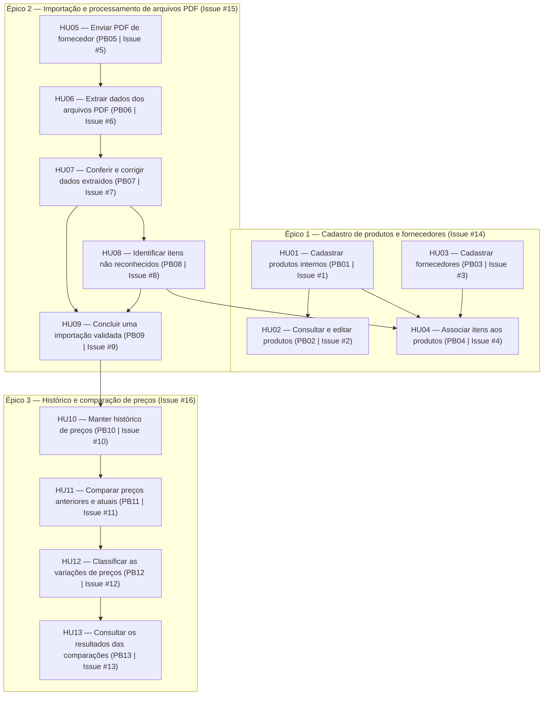

# Centro Universitário UNIESP

## Disciplina: DevOps | Professor: Jonas Bernardino

### Criação das Histórias de Usuários e do Product Backlog (2026)

> **TL;DR**
> - Entregável acadêmico da disciplina de DevOps (UNIESP) com as Histórias de Usuários (HUs) e o Product Backlog.
> - Escopo do MVP: 3 épicos, 13 histórias de usuário (HU01 a HU13) e 13 itens de Product Backlog (PB01 a PB13).
> - Rastreabilidade completa com as issues (`#1` a `#16`) e o board no GitHub Projects.
> - Fonte canônica versionada em [`.github/backlog/hus.json`](./.github/backlog/hus.json) e índice gerado em [`.github/backlog/INDEX.md`](./.github/backlog/INDEX.md).

**Grupo:**

- Alexander Augusto de Figueiredo Baxendale
- Pedro Neto Amâncio de Lima
- Rodrigo Santos Costa

---

## Visão Geral e Fluxo entre Épicos e Histórias

---

## Histórias de Usuários

### Épico 1 — Cadastro de produtos e fornecedores

#### HU01 — Cadastrar produtos internos

Como responsável pelo cadastro, quero cadastrar produtos internos com código, nome, categoria, unidade, preços de compra e venda, estoque atual, estoque mínimo e status, para manter as informações dos produtos organizados e disponíveis para consulta.

**Critérios de aceitação:**

- [ ] O sistema deve permitir cadastrar um produto com os dados necessários.
- [ ] O produto deve possuir código, nome, categoria, unidade, preço de compra, preço de venda, estoque atual, estoque mínimo e status.
- [ ] O sistema deve permitir consultar os produtos cadastrados.
- [ ] O sistema deve permitir editar as informações de um produto.
- [ ] Os dados devem ser armazenados no banco de dados.

**Prioridade**: Alta — MVP.

#### HU02 — Consultar e editar produtos

Como responsável pelo cadastro, quero consultar e editar os produtos internos, para manter os dados atualizados e facilitar a identificação dos itens durante as importações.

**Critérios de aceitação:**

- [ ] O sistema deve apresentar os produtos cadastrados.
- [ ] Deve ser possível localizar um produto pelo código ou nome.
- [ ] Deve ser possível editar os dados de um produto.
- [ ] As alterações devem ser persistidas no banco de dados.

**Prioridade**: Alta — MVP.

#### HU03 — Cadastrar fornecedores

Como responsável pelas compras, quero cadastrar e consultar fornecedores, para identificar a origem dos preços utilizados nas compras da loja.

**Critérios de aceitação:**

- [ ] O sistema deve permitir cadastrar fornecedores.
- [ ] Deve ser possível consultar os fornecedores cadastrados.
- [ ] Os fornecedores devem ser armazenados no banco de dados.
- [ ] O fornecedor deve poder ser selecionado durante a importação de um PDF.

**Prioridade**: Alta — MVP.

#### HU04 — Associar itens dos fornecedores aos produtos internos

Como responsável pelas compras, quero associar cada item ou apresentação comercial de um fornecedor a um produto interno, para garantir que as comparações de preços sejam realizadas entre produtos correspondentes.

**Critérios de aceitação:**

- [ ] O sistema deve permitir associar um item de fornecedor a um produto interno.
- [ ] A associação deve considerar a unidade e a embalagem comercial.
- [ ] Quando a correspondência não for segura, o sistema deve solicitar confirmação manual.
- [ ] O vínculo confirmado deve ser armazenado para facilitar futuras importações.
- [ ] Um código repetido, isoladamente, não deve ser considerado suficiente para identificar um produto.

**Prioridade**: Alta — MVP.

---

### Épico 2 — Importação e processamento de arquivos PDF

#### HU05 — Enviar PDF de fornecedor

Como responsável pelas compras, quero enviar um arquivo PDF associado a um fornecedor, para importar os preços comerciais sem precisar cadastrar manualmente todas as informações.

**Critérios de aceitação:**

- [ ] O sistema deve permitir selecionar o fornecedor.
- [ ] Deve ser possível enviar arquivos PDF digitais ou digitalizados compatíveis com os formatos de referência fornecidos.
- [ ] O sistema deve registrar a data da importação, o arquivo, a quantidade de itens e o status do processamento.
- [ ] Cada tentativa de importação deve ser registrada.
- [ ] O sistema deve detectar possíveis reimportações do mesmo arquivo para evitar duplicações silenciosas.

**Prioridade**: Alta — MVP.

#### HU06 — Extrair dados dos arquivos PDF

Como responsável pelas compras, quero que o sistema extraia as informações disponíveis nos PDFs, para transformar tabelas comerciais em dados estruturados que possam ser conferidos e comparados.

**Critérios de aceitação:**

- [ ] O sistema deve extrair, quando disponíveis, referência, descrição, unidade ou embalagem, quantidade e preço.
- [ ] A extração primária deve ocorrer diretamente sobre tabelas digitais (pdfplumber/PyMuPDF) com fallback automático de OCR em CPU para páginas ou documentos rasterizados sem texto nativo.
- [ ] O sistema deve processar os formatos de referência fornecidos (como docs/Fornecedor_1.pdf e docs/Fornecedor_2.pdf), suportando ausência eventual de código interno ou unidade explícita.
- [ ] Os dados extraídos devem ser apresentados para conferência.
- [ ] O sistema deve indicar inconsistências identificadas durante a extração.
- [ ] Falhas de extração devem ser registradas, sem indicar que a importação foi integralmente validada.

**Prioridade**: Alta — MVP.

#### HU07 — Conferir e corrigir dados extraídos

Como responsável pelas compras, quero visualizar e corrigir os dados extraídos de um PDF antes de confirmar a importação, para evitar que informações incorretas sejam incorporadas ao histórico de preços.

**Critérios de aceitação:**

- [ ] O sistema deve apresentar os itens extraídos para conferência.
- [ ] Deve ser possível identificar itens com informações inconsistentes.
- [ ] Itens inválidos ou não reconhecidos devem permanecer pendentes.
- [ ] O sistema deve permitir corrigir as informações necessárias.
- [ ] Apenas preços válidos e confirmados devem ser incorporados ao histórico.

**Prioridade**: Alta — MVP.

#### HU08 — Identificar itens não reconhecidos

Como responsável pelas compras, quero identificar e associar manualmente os itens que o sistema não reconhece, para manter a correspondência correta entre os produtos dos fornecedores e os produtos internos.

**Critérios de aceitação:**

- [ ] O sistema deve sinalizar itens não reconhecidos.
- [ ] Os itens devem permanecer pendentes até que sejam corrigidos ou associados.
- [ ] Deve ser possível selecionar manualmente o produto interno correspondente.
- [ ] A associação confirmada deve ser armazenada para importações futuras.
- [ ] Itens pendentes não devem ser tratados como preços válidos para comparação.

**Prioridade**: Alta — MVP.

#### HU09 — Concluir uma importação validada

Como responsável pelas compras, quero confirmar a importação após conferir os dados extraídos, para registrar os preços válidos sem perder informações históricas.

**Critérios de aceitação:**

- [ ] O sistema deve permitir concluir o processamento dos itens validados.
- [ ] Os preços válidos devem ser persistidos no banco de dados.
- [ ] Os registros anteriores não devem ser sobrescritos.
- [ ] A importação deve possuir um status que represente seu resultado.
- [ ] Falhas parciais devem ser registradas com seus erros e itens pendentes.

**Prioridade**: Alta — MVP.

---

### Épico 3 — Histórico e comparação de preços

#### HU10 — Manter histórico de preços

Como responsável pelas compras, quero consultar os preços válidos registrados em importações anteriores, para acompanhar a evolução dos preços praticados pelos fornecedores.

**Critérios de aceitação:**

- [ ] O sistema deve manter o histórico de importações.
- [ ] Os preços válidos de importações anteriores devem ser preservados.
- [ ] Deve ser possível consultar o histórico por produto, fornecedor e importação.
- [ ] Uma nova importação não deve sobrescrever os registros anteriores.
- [ ] A ausência de um item em um PDF posterior não deve apagar seu último preço válido.

**Prioridade**: Alta — MVP.

#### HU11 — Comparar preços anteriores e atuais

Como responsável pelas compras, quero comparar cada preço válido importado com o último preço válido conhecido do mesmo item, fornecedor e apresentação comercial, para identificar alterações nos custos de compra.

**Critérios de aceitação:**

- [ ] A comparação deve utilizar o último preço válido conhecido do mesmo fornecedor e apresentação comercial.
- [ ] A comparação deve considerar unidade e embalagem.
- [ ] O sistema deve apresentar o preço anterior e o preço atual.
- [ ] Deve calcular a diferença absoluta entre os preços.
- [ ] Deve calcular a variação percentual utilizando a fórmula: Variação Percentual = (Preço Atual - Preço Anterior) / Preço Anterior × 100.
- [ ] O cálculo percentual somente deve ser realizado quando o preço anterior for maior que zero.
- [ ] Quando não existir preço anterior, o item deve ser classificado como novo, sem calcular percentual.

**Prioridade**: Alta — MVP.

#### HU12 — Classificar as variações de preços

Como responsável pelas compras, quero que o sistema classifique os resultados da comparação, para identificar rapidamente os itens que exigem atenção.

**Critérios de aceitação:**

- [ ] Aumentou: preço atual maior que o anterior.
- [ ] Diminuiu: preço atual menor que o anterior.
- [ ] Sem alteração: preço atual igual ao anterior.
- [ ] Novo: item sem preço base anterior.
- [ ] Pendente: item que necessita de correção, validação ou associação.
- [ ] A classificação deve ser exibida por meio de rótulos textuais e, quando apropriado, ícones ou setas.
- [ ] A interface não deve depender exclusivamente de cores para comunicar as alterações.

**Prioridade**: Alta — MVP.

#### HU13 — Consultar os resultados das comparações

Como responsável pelas compras, quero visualizar os resultados das comparações de preços, para decidir quais fornecedores e produtos precisam de uma análise mais detalhada.

**Critérios de aceitação:**

- [ ] O sistema deve exibir o preço anterior e o atual.
- [ ] Deve apresentar a diferença absoluta e a variação percentual, quando aplicável.
- [ ] Deve exibir a classificação de cada item.
- [ ] Deve permitir consultar os resultados por produto, fornecedor e importação.
- [ ] Itens novos e pendentes devem ser identificados corretamente.

**Prioridade**: Alta — MVP.

---

## Backlog do Sistema de Monitoramento de Preços, Estoque e Compras

| ID | História de usuário | Item do Product Backlog | Prioridade | Critérios de aceitação |
| :--- | :--- | :--- | :--- | :--- |
| PB01 | HU01 | Desenvolver a funcionalidade de cadastro de produtos internos. | Alta | O sistema deve permitir cadastrar produtos com código, nome, categoria, unidade, preço de compra, preço de venda, estoque atual, estoque mínimo e status. |
| PB02 | HU02 | Desenvolver as funcionalidades de consulta e edição de produtos. | Alta | O sistema deve permitir consultar os produtos cadastrados, localizar produtos pelo código ou nome e editar suas informações. |
| PB03 | HU03 | Desenvolver a funcionalidade de cadastro e consulta de fornecedores. | Alta | O sistema deve permitir cadastrar e consultar fornecedores e armazenar seus dados no banco de dados. |
| PB04 | HU04 | Implementar a associação entre itens dos fornecedores e produtos internos. | Alta | O sistema deve permitir associar itens considerando a unidade e a embalagem comercial, com possibilidade de associação manual. |
| PB05 | HU05 | Desenvolver a funcionalidade de envio de arquivos PDF vinculados a fornecedores. | Alta | O sistema deve permitir selecionar o fornecedor, enviar o PDF e registrar a data, o arquivo, a quantidade de itens e o status da importação. |
| PB06 | HU06 | Implementar a extração de informações dos arquivos PDF. | Alta | O sistema deve extrair, quando disponíveis, referência, descrição, unidade ou embalagem, quantidade e preço, apresentando os dados para conferência. |
| PB07 | HU07 | Desenvolver a tela de conferência e correção dos dados extraídos. | Alta | O sistema deve permitir visualizar os itens importados, identificar inconsistências e corrigir os dados antes da confirmação. |
| PB08 | HU08 | Implementar a identificação e a associação manual de itens não reconhecidos. | Alta | O sistema deve sinalizar itens não reconhecidos, permitir sua associação a produtos internos e armazenar os vínculos confirmados. |
| PB09 | HU09 | Implementar a confirmação e a finalização das importações validadas. | Alta | O sistema deve permitir confirmar os dados válidos, persistir os preços e registrar o status da importação, preservando os históricos anteriores. |
| PB10 | HU10 | Desenvolver o armazenamento e a consulta do histórico de preços. | Alta | O sistema deve preservar os preços anteriores e permitir consultar o histórico por produto, fornecedor e importação. |
| PB11 | HU11 | Implementar a comparação entre preços anteriores e atuais. | Alta | O sistema deve comparar o preço atual com o último preço válido do mesmo item, fornecedor e apresentação comercial, calculando a diferença absoluta e a variação percentual quando aplicável. |
| PB12 | HU12 | Implementar a classificação das variações de preços. | Alta | O sistema deve classificar os itens como aumentou, diminuiu, sem alteração, novo ou pendente. |
| PB13 | HU13 | Desenvolver a interface de consulta dos resultados das comparações. | Alta | O sistema deve apresentar preço anterior, preço atual, diferença absoluta, variação percentual quando aplicável e classificação do item. |

---

## Anexo — Rastreabilidade no GitHub

As histórias e os épicos deste documento estão registrados como issues do repositório [rodrigosantoscosta/Projeto_DevOps](https://github.com/rodrigosantoscosta/Projeto_DevOps). A fonte viva do backlog é o GitHub Issues + Project ([Product Backlog — Projeto DevOps](https://github.com/users/rodrigosantoscosta/projects/2)); este arquivo é o recorte acadêmico.

| Item | Issue | Item | Issue |
| :--- | :--- | :--- | :--- |
| Épico 1 — Cadastro de produtos e fornecedores | [#14](https://github.com/rodrigosantoscosta/Projeto_DevOps/issues/14) | HU08 — Identificar itens não reconhecidos | [#8](https://github.com/rodrigosantoscosta/Projeto_DevOps/issues/8) |
| Épico 2 — Importação e processamento de arquivos PDF | [#15](https://github.com/rodrigosantoscosta/Projeto_DevOps/issues/15) | HU09 — Concluir uma importação validada | [#9](https://github.com/rodrigosantoscosta/Projeto_DevOps/issues/9) |
| Épico 3 — Histórico e comparação de preços | [#16](https://github.com/rodrigosantoscosta/Projeto_DevOps/issues/16) | HU10 — Manter histórico de preços | [#10](https://github.com/rodrigosantoscosta/Projeto_DevOps/issues/10) |
| HU01 — Cadastrar produtos internos | [#1](https://github.com/rodrigosantoscosta/Projeto_DevOps/issues/1) | HU11 — Comparar preços anteriores e atuais | [#11](https://github.com/rodrigosantoscosta/Projeto_DevOps/issues/11) |
| HU02 — Consultar e editar produtos | [#2](https://github.com/rodrigosantoscosta/Projeto_DevOps/issues/2) | HU12 — Classificar as variações de preços | [#12](https://github.com/rodrigosantoscosta/Projeto_DevOps/issues/12) |
| HU03 — Cadastrar fornecedores | [#3](https://github.com/rodrigosantoscosta/Projeto_DevOps/issues/3) | HU13 — Consultar os resultados das comparações | [#13](https://github.com/rodrigosantoscosta/Projeto_DevOps/issues/13) |
| HU04 — Associar itens dos fornecedores aos produtos internos | [#4](https://github.com/rodrigosantoscosta/Projeto_DevOps/issues/4) | SETUP: Infraestrutura Docker Compose | [#17](https://github.com/rodrigosantoscosta/Projeto_DevOps/issues/17) |
| HU05 — Enviar PDF de fornecedor | [#5](https://github.com/rodrigosantoscosta/Projeto_DevOps/issues/5) | SETUP: Backend (NestJS + Prisma) | [#18](https://github.com/rodrigosantoscosta/Projeto_DevOps/issues/18) |
| HU06 — Extrair dados dos arquivos PDF | [#6](https://github.com/rodrigosantoscosta/Projeto_DevOps/issues/6) | SETUP: Frontend (React + Vite) | [#19](https://github.com/rodrigosantoscosta/Projeto_DevOps/issues/19) |
| HU07 — Conferir e corrigir dados extraídos | [#7](https://github.com/rodrigosantoscosta/Projeto_DevOps/issues/7) | SETUP: Extrator PDF (FastAPI + pdfplumber) | [#20](https://github.com/rodrigosantoscosta/Projeto_DevOps/issues/20) |

O índice completo, gerado a partir das issues, está em [`.github/backlog/INDEX.md`](./.github/backlog/INDEX.md), e a fonte versionada que alimenta a sincronização está em [`.github/backlog/hus.json`](./.github/backlog/hus.json).
Cada issue contém os critérios de aceitação em formato de checklist e a branch sugerida para a HU.
