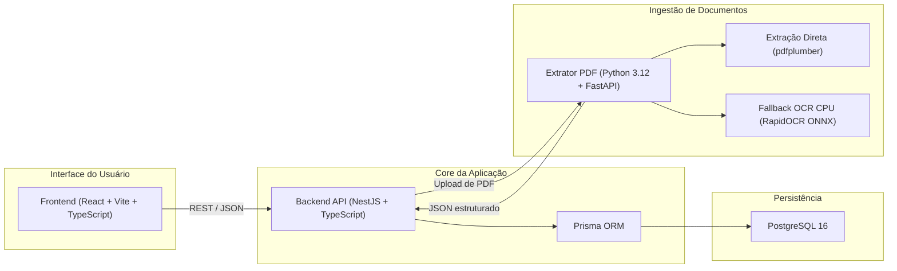
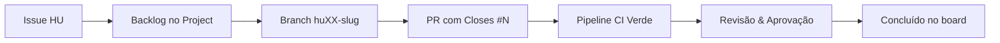

# Projeto DevOps — Monitoramento de Preços, Estoque e Compras

> **TL;DR**
> - Repositório da disciplina de DevOps (Centro Universitário UNIESP).
> - Stack: **TypeScript (NestJS + React) + Prisma ORM + PostgreSQL 16 + Microserviço Python (FastAPI + pdfplumber + RapidOCR fallback)**.
> - Backlog e HUs vivem no GitHub: Issues + Project **Product Backlog — Projeto DevOps**.
> - Escopo do MVP: 3 épicos, 13 histórias de usuário e 13 itens de Product Backlog.
> - CI automatizada em [`.github/workflows/ci.yml`](.github/workflows/ci.yml) e decisão técnica em [`docs/adr-001-stack-e-arquitetura.md`](docs/adr-001-stack-e-arquitetura.md).

## Equipe

- Alexander Augusto de Figueiredo Baxendale
- Pedro Neto Amâncio de Lima
- Rodrigo Santos Costa

---

## Arquitetura e Stack Tecnológica

O sistema foi desenhado para operar com serviços desacoplados em containers Docker, viabilizando execução local leve e pipelines de CI em CPU padrão (sem dependência de GPU).



### Componentes Principais

| Componente | Tecnologia | Papel no Sistema |
| :--- | :--- | :--- |
| **Backend API** | TypeScript, NestJS, Prisma ORM | Regras de negócio, autenticação, cadastro de produtos/fornecedores (HU01–HU04), histórico e comparação de preços (HU10–HU13). |
| **Frontend SPA** | React, TypeScript, Vite | Telas de cadastro, conferência e correção humana de extração (HU07, HU08) e dashboards de cotação (HU13). |
| **Extrator PDF** | Python 3.12, FastAPI, pdfplumber | Serviço stateless de extração tabular direta (milissegundos) com fallback OCR em CPU via RapidOCR para documentos rasterizados. |
| **Banco de Dados** | PostgreSQL 16 | Armazenamento relacional com integridade estrita e controle de migrations versionadas. |
| **Infraestrutura** | Docker Compose, GitHub Actions | Orquestração de containers para ambiente local e esteira de CI contínua para lint, testes e validação. |

Para entender os trade-offs e o descarte de modelos pesados com GPU, consulte o documento de decisão arquitetural: [`docs/adr-001-stack-e-arquitetura.md`](docs/adr-001-stack-e-arquitetura.md).

---

## Estrutura do Repositório

```text
.github/
  ISSUE_TEMPLATE/           # Formulários para criação padronizada de issues
  PULL_REQUEST_TEMPLATE.md  # Checklist de Definition of Done e rastreabilidade
  workflows/
    ci.yml                  # Pipeline de CI (documentação, integridade, checks)
  backlog/
    hus.json                # Fonte versionada canônica (épicos, HUs, critérios)
    INDEX.md                # Índice gerado de rastreabilidade
docs/
  adr-001-stack-e-arquitetura.md # Registro formal de decisões de arquitetura (ADR)
  Fornecedor_1.pdf          # Amostra de referência de PDF tabular
  Fornecedor_2.pdf          # Amostra de referência sem código interno
scripts/
  sync-backlog.ps1          # Sincronização idempotente com o GitHub Projects
  validate-docs.py          # Validador determinístico de links GFM e sintaxe Mermaid
HU e Backlog.md             # Entregável acadêmico formal para a UNIESP
README.md                   # Documentação consolidada do repositório
```

---

## Backlog e Histórias de Usuário

O backlog é operado no GitHub, não em planilha:

| Recurso | Onde |
| :--- | :--- |
| Product Backlog (board) | [Product Backlog — Projeto DevOps](https://github.com/users/rodrigosantoscosta/projects/2) |
| Épicos | issues com label `tipo:epico` |
| Histórias de usuário | issues com label `tipo:hu` |
| Índice gerado | [`.github/backlog/INDEX.md`](.github/backlog/INDEX.md) |
| Entregável acadêmico | [`HU e Backlog.md`](HU%20e%20Backlog.md) |
| Fonte versionada | [`.github/backlog/hus.json`](.github/backlog/hus.json) |

### Fluxo de Trabalho e Rastreabilidade



| Convenção | Padrão |
| :--- | :--- |
| Branch de HU | `hu01-cadastrar-produtos` (sugestão indicada na issue) |
| Branch de defeito | `fix/<slug>` |
| Commit | `feat(hu01): cadastro de produtos` |
| PR | título com o ID da HU e `Closes #<issue>` no corpo |
| Status do board | Backlog, Refinamento, Pronto, Em andamento, Em review, Concluído |

---

## Pipeline de CI (GitHub Actions)

A esteira de integração contínua é definida em [`.github/workflows/ci.yml`](.github/workflows/ci.yml) e é disparada a cada push ou Pull Request direcionado para a branch `master`:

1. **Validação de Documentação (`validate-docs`):** Executa `scripts/validate-docs.py` para garantir que nenhum link Markdown relativo esteja quebrado, que nenhum caminho absoluto local vaze para o repositório, que a sintaxe dos diagramas Mermaid seja 100% compatível com o GitHub e que a regra Zero Emojis seja respeitada.
2. **Integridade do Backlog (`validate-backlog`):** Verifica o schema do [`.github/backlog/hus.json`](.github/backlog/hus.json) garantindo a presença dos 3 épicos e 13 HUs.
3. **Módulos de Aplicação (`backend-check` e `extractor-check`):** Estrutura condicional preparada para executar linting, typechecking e testes automatizados assim que o código-fonte for adicionado aos respectivos diretórios.

---

## Sincronização do Backlog

Pré-requisito: `gh` autenticado com escopo de Projects.

```powershell
gh auth refresh -h github.com -s project
```

Comandos úteis:

```powershell
# 1. Conferir o plano sem alterar nada
.\scripts\sync-backlog.ps1

# 2. Aplicar labels, milestone, issues e Project
.\scripts\sync-backlog.ps1 -Apply -ExportIndex

# 3. Reexecutar quando o hus.json mudar
.\scripts\sync-backlog.ps1 -Apply -UpdateExisting -ExportIndex

# 4. Apontar para um Project já criado na interface (por número ou título)
.\scripts\sync-backlog.ps1 -Scope project -ProjectNumber 1 -Apply
```
