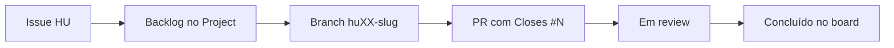

# Projeto DevOps — Monitoramento de Preços, Estoque e Compras

> **TL;DR**
> - Repositório da disciplina de DevOps (Centro Universitário UNIESP).
> - Backlog e HUs vivem no GitHub: Issues + Project **Product Backlog — Projeto DevOps**.
> - Escopo do MVP: 3 épicos, 13 histórias de usuário e 13 itens de Product Backlog.
> - Fluxo: issue (HU) -> branch `huXX-<slug>` -> PR com `Closes #N` -> board.
> - Sincronização reproduzível via `scripts/sync-backlog.ps1` (dry-run por padrão).

## Equipe

- Alexander Augusto de Figueiredo Baxendale
- Pedro Neto Amâncio de Lima
- Rodrigo Santos Costa

## Backlog e Histórias de Usuário

O backlog é operado no GitHub, não em planilha:

| Recurso | Onde |
| --- | --- |
| Product Backlog (board) | [Product Backlog — Projeto DevOps](https://github.com/users/rodrigosantoscosta/projects/2) |
| Épicos | issues com label `tipo:epico` |
| Histórias de usuário | issues com label `tipo:hu` |
| Índice gerado | [`.github/backlog/INDEX.md`](.github/backlog/INDEX.md) |
| Entregável acadêmico | [`HU e Backlog.md`](HU%20e%20Backlog.md) |
| Fonte versionada | [`.github/backlog/hus.json`](.github/backlog/hus.json) |

A fonte viva é o GitHub. O arquivo `HU e Backlog.md` é o recorte entregue à disciplina e o
`hus.json` é a receita que permite recriar o backlog de forma reproduzível.

### Estrutura dos artefatos

```text
.github/
  ISSUE_TEMPLATE/
    hu.yml                  # formulário de História de Usuário
    epico.yml               # formulário de Épico
    bug.yml                 # formulário de Defeito
    config.yml              # desabilita issue em branco
  PULL_REQUEST_TEMPLATE.md  # checklist de DoD + rastreabilidade
  backlog/
    hus.json                # fonte versionada (épicos, HUs, PB, critérios)
    INDEX.md                # gerado pelo script
scripts/
  sync-backlog.ps1          # sincronização idempotente com o GitHub
```

### Fluxo de trabalho



| Convenção | Padrão |
| --- | --- |
| Branch de HU | `hu01-cadastrar-produtos` (sugestão aparece na issue) |
| Branch de defeito | `fix/<slug>` |
| Commit | `feat(hu01): cadastro de produtos` |
| PR | título com o ID da HU e `Closes #<issue>` no corpo |
| Status do board | Backlog, Refinamento, Pronto, Em andamento, Em review, Concluído |

### Sincronização do backlog

Pré-requisito: `gh` autenticado com escopo de Projects.

```powershell
gh auth refresh -h github.com -s project
```

Uso:

```powershell
# 1. Conferir o plano sem alterar nada
.\scripts\sync-backlog.ps1

# 2. Aplicar labels, milestone, issues e Project
.\scripts\sync-backlog.ps1 -Apply -ExportIndex

# 3. Reexecutar quando o hus.json mudar
.\scripts\sync-backlog.ps1 -Apply -UpdateExisting -ExportIndex

# 4. Apontar para um Project já criado na interface (por número ou título)
.\scripts\sync-backlog.ps1 -Scope project -ProjectNumber 1 -Apply
```

O script é idempotente: identifica cada issue pelo marcador `<!-- hu-id: HUxx -->` no corpo,
cria apenas o que falta e preserva edições feitas na interface, exceto com `-UpdateExisting`.

### Ajustes que só existem na interface do GitHub

A API pública de Projects v2 não expõe criação de views nem workflows:

1. Criar a view **Board** agrupada por Status e a view **Tabela** ordenada por `PB`.
2. Ativar os workflows *Auto-add to project* (filtro `is:issue`) e *Item closed -> Concluído*.
   O filtro aceita um único critério; para separar HUs de defeitos, duplique o workflow
   auto-add e use `label:tipo:hu` em um e `label:tipo:bug` no outro.

As opções do campo **Status** já são configuradas pelo script com `-ConfigureStatus`:
Backlog, Refinamento, Pronto, Em andamento, Em review, Concluído.
