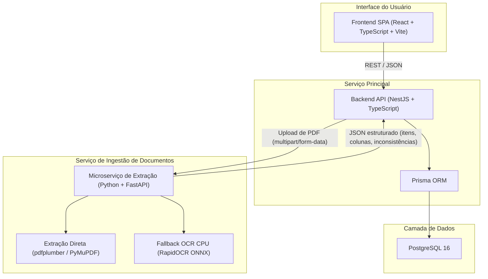

# ADR 001 — Definição da Stack Tecnológica e Arquitetura de Serviços

> **TL;DR**
> - Backend central em **TypeScript (NestJS)** com **Prisma ORM** e **PostgreSQL 16**.
> - Frontend em **React (Vite / TypeScript)** com componentes modulares.
> - Microserviço dedicado de extração em **Python (FastAPI)** com **pdfplumber** e fallback **RapidOCR (CPU/ONNX)**.
> - Exclusão de modelos VLM dependentes de GPU (`SoMarkAI/OXR`, `olmOCR`, `Chandra`) para viabilizar CI e execução local em CPU.
> - Orquestração com **Docker Compose** e validação contínua via **GitHub Actions**.

---

## 1. Contexto

O projeto consiste no desenvolvimento do **Sistema de Monitoramento de Preços, Estoque e Compras**, concebido no escopo da disciplina de DevOps do Centro Universitário UNIESP. O sistema tem como objetivo automatizar o cadastro de produtos, fornecedores e o processamento de listas de preços enviadas em arquivos PDF, mantendo histórico rastreável e calculando variações percentuais e absolutas entre cotações.

Os requisitos centrais do sistema abrangem:
- **Épico 1 (Cadastro):** Gestão de produtos internos, fornecedores e de-para de itens comerciais.
- **Épico 2 (Importação PDF):** Ingestão de arquivos PDF de diferentes layouts comerciais, extração estruturada de itens, conferência humana para itens pendentes e persistência de dados validados.
- **Épico 3 (Histórico e Comparações):** Comparação do preço atual com o último preço válido por fornecedor/apresentação, cálculo de variação percentual e classificação visual.

A análise empírica das amostras reais de fornecedores revelou que os documentos são predominantemente PDFs digitais com texto nativo, porém com formatos heterogêneos de colunas (alguns fornecedores omitem código interno ou unidade). Adicionalmente, para garantir robustez operacional diante de eventuais PDFs digitalizados (escaneados), é necessário contar com um mecanismo generalista de fallback para OCR que opere estritamente em **CPU**, tanto para desenvolvimento local quanto para os runners do GitHub Actions.

---

## 2. Decisão

Adotou-se uma arquitetura de serviços desacoplados conteinerizados via **Docker Compose**:

### 2.1 Componentes da Stack

1. **Backend Principal:**
   - **Framework:** NestJS (Node.js / TypeScript).
   - **ORM:** Prisma ORM com tipagem fim a fim e controle de migrations versionadas.
   - **Responsabilidades:** Autenticação, regras de negócio de produtos e fornecedores (HU01 a HU04), orquestração de importações (HU05, HU09), motor de comparação e histórico de preços (HU10 a HU13).

2. **Frontend:**
   - **Framework:** React com TypeScript e Vite.
   - **Responsabilidades:** Interface responsiva para conferência de extração (HU07, HU08), consulta e edição de cadastros (HU02) e visualização de comparações de preços (HU13) sem popups bloqueantes.

3. **Microserviço de Extração (Extrator PDF):**
   - **Tecnologia:** Python 3.12 com FastAPI.
   - **Estratégia de Parsing Híbrida (CPU-Only):**
     - *Nível 1 (Primário):* Extração nativa de tabelas e textos via `pdfplumber` / `PyMuPDF`. Execução em milissegundos, consumo mínimo de memória e fidelidade numérica total (sem alucinações).
     - *Nível 2 (Fallback):* Mecanismo de OCR baseado em `RapidOCR` (ONNX Runtime otimizado para CPU), acionado automaticamente caso o PDF não contenha texto selecionável ou apresente camadas rasterizadas.
   - **Natureza:** Serviço *stateless*, facilitando testes automatizados isolados no CI com fixtures reais.

4. **Banco de Dados:**
   - **PostgreSQL 16:** Banco relacional com integridade referencial estrita para histórico de preços e logs de importação.

5. **Infraestrutura e DevOps:**
   - **Docker & Docker Compose:** Subida de todo o ambiente (`api`, `web`, `pdf-extractor`, `postgres`) com um comando.
   - **GitHub Actions:** Pipeline de validação contínua (linting, tipagem, testes e integridade de documentação).

---

## 3. Alternativas Descartadas

| Alternativa | Motivo do Descarte |
| :--- | :--- |
| **Modelos VLM com GPU (`SoMarkAI/OXR`, `olmOCR`, `Chandra`, `MinerU`)** | Exigem GPUs dedicadas com 16 GB a 24 GB de VRAM e backends como `vLLM`. Inviáveis para execução padrão nos runners gratuitos do GitHub Actions e em máquinas de desenvolvimento convencionais. |
| **Monolito exclusivo em Python (FastAPI + Jinja/React)** | Embora eficiente para o PDF, a equipe optou pela consistência e ecossistema empresarial de TypeScript com NestJS no backend corporativo e React no frontend. |
| **Extração de PDF exclusiva em Node.js (`pdfjs-dist` / `pdf-parse`)** | A manipulação e recuperação estruturada de tabelas e coordenadas em bibliotecas Node.js é consideravelmente mais complexa e menos precisa que o ecossistema Python (`pdfplumber` / `PyMuPDF`), além da falta de motores de OCR leves consolidados para Node.js. |
| **OCR pesado baseado em Tesseract tradicional** | Configuração pesada de pacotes de sistema (`libtesseract`, `tesseract-ocr-por`) no container e velocidade inferior em CPU quando comparado ao runtime ONNX do RapidOCR. |

---

## 4. Consequências

### 4.1 Positivas
- **Velocidade de Execução:** Extração digital em milissegundos sem sobrecarga de inferência neural desnecessária.
- **Portabilidade no CI:** 100% executável em runners CPU padrão do GitHub Actions sem custos adicionais de runners auto-hospedados com GPU.
- **Isolamento de Responsabilidades:** O backend NestJS não precisa lidar com bibliotecas de manipulação gráfica ou binários C++ de PDF; comunica-se via contrato JSON padronizado.
- **Resiliência:** O fallback de OCR garante suporte a documentos escaneados sem quebrar o fluxo de processamento.

### 4.2 Trade-offs e Mitigações
- **Manutenção de dois ecossistemas (Node.js e Python):** Mitigado pelo uso de Docker Compose e pela natureza restrita e especializada do serviço Python (escopo delimitado à extração).
- **Consistência de Contratos de API:** O schema de resposta do extrator deve ser rigidamente tipado no NestJS através de DTOs compartilhados ou contratos OpenAPI.
